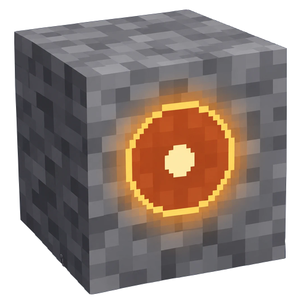
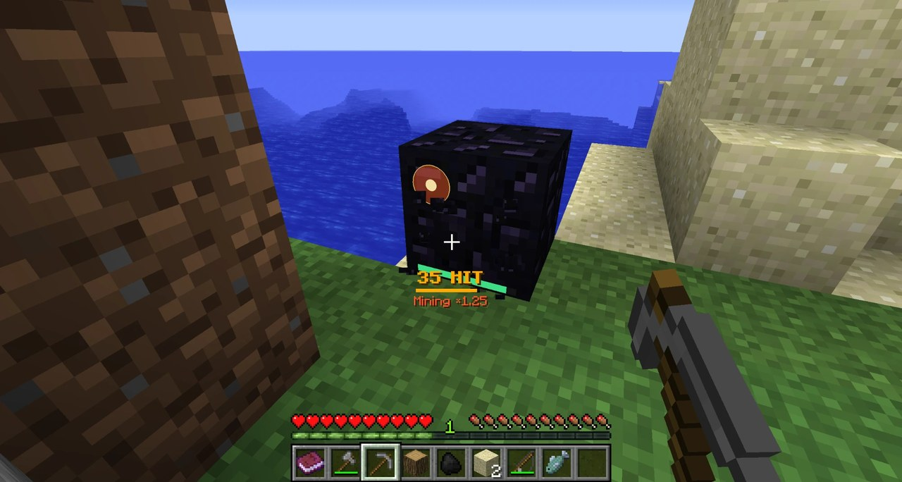

# Weak Spot Mining

[日本語](README.md) | English

A Minecraft mod that brings Fortnite's "weak spot" harvesting to Minecraft. A glowing circle (a weak spot) appears while you mine, farm, ride, draw a bow and more. Aim at it to speed things up.

## ⬇ Download

- **[CurseForge](https://www.curseforge.com/minecraft/mc-mods/weakspot)**

Requires **Minecraft Java Edition 1.12.2 + Forge** (developed and tested with 14.23.5.2860; much older Forge builds may not run every feature) or **1.21.1 + NeoForge** (developed and tested with 21.1.264). Pick the file for your Minecraft version on the download page.

For multiplayer, install it on the server **and** on every player's client, all on the same minor version (for example 1.12.x) and the same Minecraft version. In single player, only your client needs it.

## Controls

| Key | Action |
|---|---|
| **K** | Weak Spot menu (stats, hit sounds, per-kind on/off, colors and shapes, settings, guide book) |
| **HOME** | Turn all weak spots on or off (for example while building) |
| **Right click** (holding a Weak Spot Target) | 30-second target practice: aim at the red-and-white targets, avoid the yellow ✕. Your best score unlocks new marker looks |

You can change the keys under Options → Controls → Weak Spot Mining.

## Kinds of weak spots

There are 19 kinds: mining, growth, harvest, machine, animal, fishing, bow, melee, throwing, eating, vehicle, ladder, sprint, elytra, portal, swim, fall, sleeping and enchanting. See the [CurseForge page](https://www.curseforge.com/minecraft/mc-mods/weakspot) for how each one works, or the in-game guide book (the Guide button in the K menu). Hitting spots in a row builds a **combo**, and the hit sound climbs the scale.

## Recent updates

### 1.12.3

- 1.21.1: weak spots for the mace, trident, crossbow and crafter

### 1.12.2

- Release files now include the loader name (no gameplay changes)

### 1.12.1

- Weak spots are easier to hit on complex blocks and piped machines

## More

- Settings: the Mods menu or `config/weakspot.cfg` (every setting has an English description).
- Bugs: type `/weakspot bug` in chat to get a link to a prefilled [issue](https://github.com/zeusisgood/weakspot/issues) with your environment.
- Other documents (detailed guide, settings list) are in Japanese: [doc/](doc/).

## For developers

- Requires JDK 8. Built with the official Forge MDK (Forge 14.23.5.2860, ForgeGradle 3 + Gradle 4.9).
- `cd mc1.12.2 && ./gradlew build` builds and tests (jar in `mc1.12.2/build/libs/`). `./gradlew runServer` starts a dev server.
- Both the server and the client need the mod. `common/` holds pure logic with no Minecraft classes (unit-tested, shared by every Minecraft version's build); `lang/` holds the translations; `mc1.12.2/` holds the 1.12.2 build with its `client/` and `server/` sides.
- Design notes and the release checklist are in Japanese: [doc/development.md](doc/development.md), [doc/architecture.md](doc/architecture.md), [doc/roadmap.md](doc/roadmap.md).
- Issues and pull requests are welcome (in English or Japanese).

## License

[MIT License](LICENSE).

- **Modpacks are welcome.** No permission needed. If you add it to a pack, I'd love to hear about it through an [issue](https://github.com/zeusisgood/weakspot/issues/new/choose) ("Modpack notice"), but it's entirely optional.
- When sharing the mod, a link to the [CurseForge page](https://www.curseforge.com/minecraft/mc-mods/weakspot) is appreciated.
